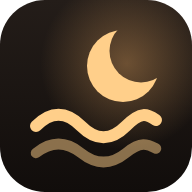
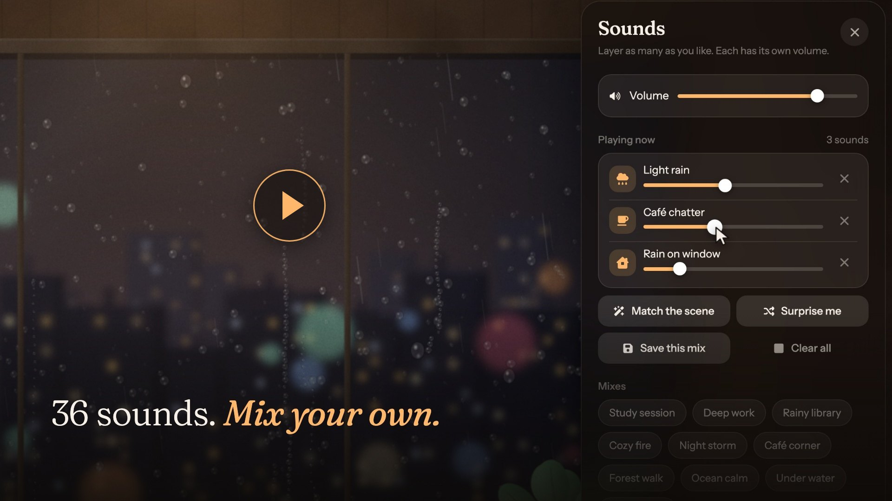
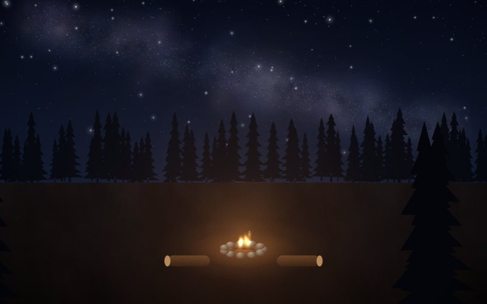
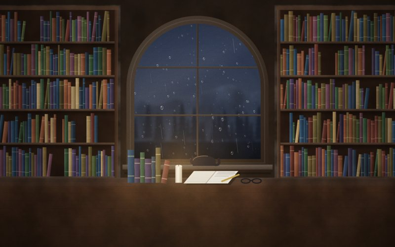
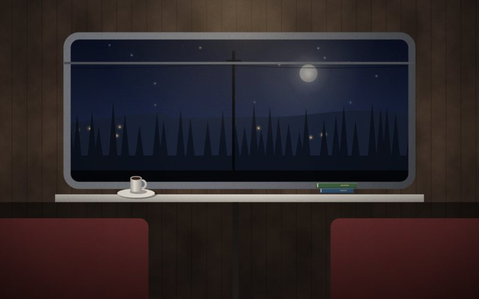
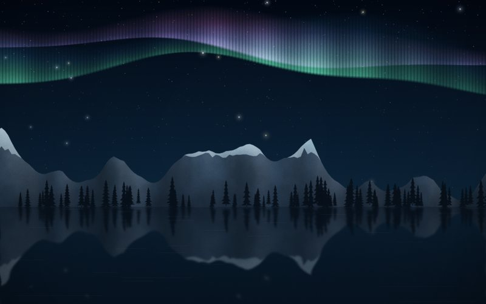
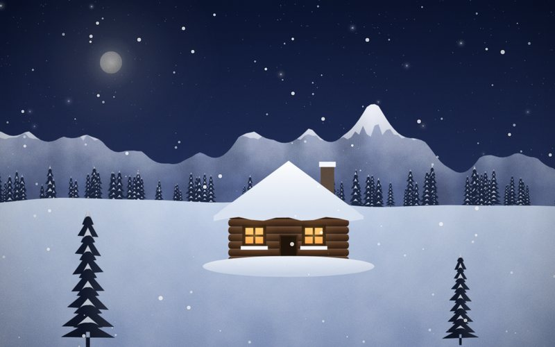
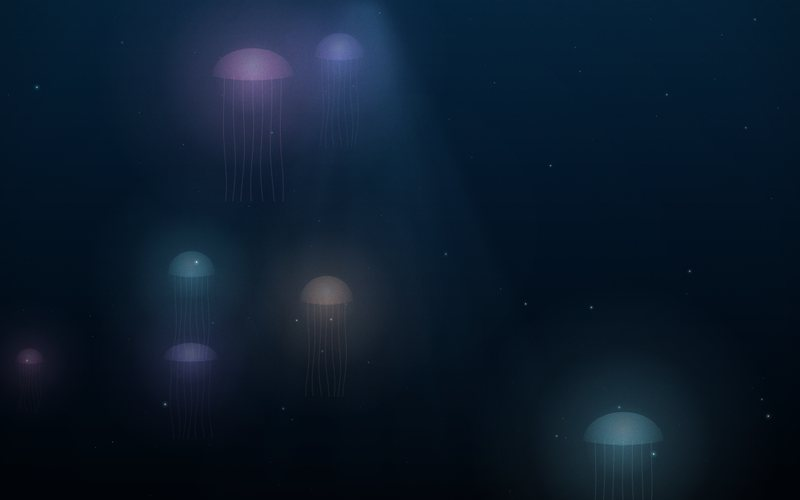
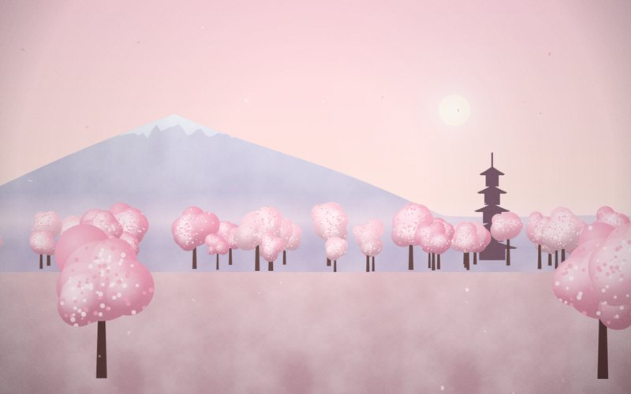
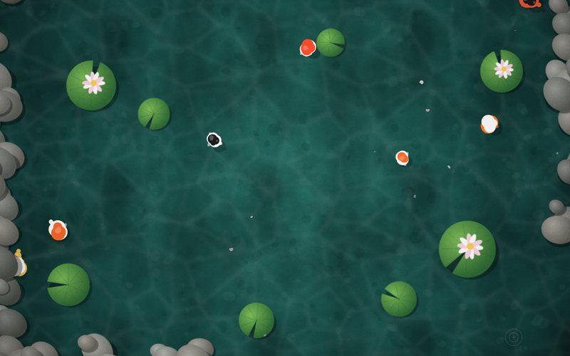

<h1>Earmuff</h1>

<i>A little warmth for your focus.</i>

  
  
  
  
  
  

 

It's late. Rain runs down the window, the lamp is on, and a cup is going cold beside your notes. Somewhere a fire crackles. The world outside goes soft and far away, and it's just you and the thing you're working on.

**That's what Earmuff is for.** Pick a place, put your earmuffs on, and stay with your work. No feed waiting to pull you away, no ad cutting into the rain, nothing to sign up for. Just background sounds, and a little warmth while you focus.

 

▶ Take the 22-second tour

## Find your spot

Every scene is a small living place with its own sounds already playing. Sit by a campfire, ride a night train, or watch jellyfish drift past in the deep sea. There are 37 of them.

<table>
  <tr>
    <td width="33%"> <b>Campfire</b> · a crackling fire under the stars</td>
    <td width="33%"> <b>Library nook</b> · bookshelves, candlelight and rain</td>
    <td width="33%"> <b>Night train</b> · the countryside passing in the dark</td>
  </tr>
  <tr>
    <td width="33%"> <b>Northern lights</b> · the aurora over a frozen lake</td>
    <td width="33%"> <b>Snowy cabin</b> · a warm cabin in the snow</td>
    <td width="33%"> <b>Deep sea</b> · jellyfish, dark water and whale song</td>
  </tr>
  <tr>
    <td width="33%"> <b>Sakura drift</b> · petals, a pagoda and a distant mountain</td>
    <td width="33%"> <b>Koi pond</b> · koi, lily pads and a gentle stream</td>
    <td width="33%"> <b>Pixel sunset</b> · a retro sunset over a glowing grid</td>
  </tr>
</table>

Also a rainy café window, a thunderstorm, a lighthouse, a waterfall, floating islands, a blocky cave and 22 more.

## Not another tab

You know how it goes. You put on a lo-fi stream to study, and twenty minutes later you're three videos deep, wondering where the time went.

Earmuff has nowhere to wander off to. There's no sidebar, no autoplay, no comments and no "up next", only the sound you chose. When you need a break, the focus timer tells you, so the break is one you planned.

## What's playing

**Real sounds, mixed your way.** There are 36 of them: rain on glass, distant thunder, café chatter, a crackling fire, wind in the pines, waves, a train on its tracks. Layer as many as you like and set each one as loud or as soft as you want. Brown, pink and white noise are there too.

**Lo-fi that never runs out.** The music is made live in your browser, so it keeps going for as long as you do. You can also play your own audio files.

**A gentle timer.** A Pomodoro timer and a small task list sit right beside the sounds. A soft chime tells you when it's time for a break.

**Yours, and only yours.** There's no account and no ads, and nothing tracks what you listen to. Your mixes and settings stay in your browser. Once a sound has played, it keeps working offline, and you can add Earmuff to your home screen like an app.

 

### Your earmuffs are on the desk.

  

Free · No account · No ads · Works offline* 
* After your first visit, for the sounds you have already played.

 

---

<b>Credits</b>

 

Made by **Jan Blomme**, who came up with Earmuff and built the app.

With help from two AI assistants:

- **Claude** (Anthropic) helped find more sounds, and later with the rename to Earmuff and this README.
- **Cursor** helped with the tedious technical work.

Sounds, icons and type:

- Field recordings from [Moodist](https://github.com/remvze/moodist) (Pixabay Content License and CC0) and [Blanket](https://github.com/rafaelmardojai/blanket) (CC0)
- Icons from [Font Awesome](https://fontawesome.com/) (CC BY 4.0)
- Typefaces [Fraunces](https://fonts.google.com/specimen/Fraunces) and [Instrument Sans](https://fonts.google.com/specimen/Instrument+Sans) (SIL Open Font License)

The same credits live in `humans.txt` and in Settings inside the app.

<b>License</b>

 

Earmuff is licensed under the [GNU Affero General Public License v3.0](LICENSE). If you host a changed copy, its source has to stay open too.

Copyright © 2026 Jan Blomme. Recordings, fonts and icons keep their own licenses, listed after the AGPL text in [LICENSE](LICENSE).

