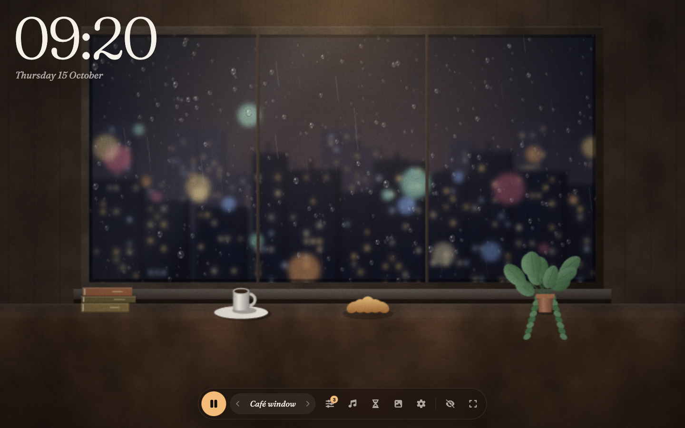

# Quiet Hours



Lo-fi, rain and real ambient sounds for studying. [Quiet Hours](https://quiethours-study.netlify.app/) is a static site: upload this folder to a web host and it works. There is no build step, no server code and no database.

## Live site

The published copy is [https://quiethours-study.netlify.app/](https://quiethours-study.netlify.app/).

Canonical links, share cards, `sitemap.xml`, `robots.txt`, `llms.txt` and `llms-full.txt` already use that address. The café window is the scene that opens first.

## What it includes

- 37 scene pages. A link such as `/?scene=campfire` opens that scene too.
- 36 mixable sounds: 33 MP3 field recordings, plus brown, pink and white noise generated in the browser.
- Lo-fi music generated in the browser, or audio files from the visitor's device.
- A Pomodoro focus timer.
- Saved mixes.
- Offline playback after a sound has already played.
- No account and no ads.

Settings, mixes and tasks stay in the visitor's browser.

Each recording downloads the first time it is switched on. Serve the site over HTTPS. Offline mode and Add to Home Screen need HTTPS, or localhost.

## Deploy

Netlify is the host for the live site. To publish this folder yourself, upload its contents to the site root. A subfolder works as well, except the 404 page expects to live at the root.

- **Netlify or Cloudflare Pages.** `_headers` is included. Drag the folder in. No build command.
- **Apache.** `.htaccess` is included (caching, compression, file types, 404 page).
- **Nginx.** Example for this hostname:

```nginx
server {
  server_name quiethours-study.netlify.app;
  root /var/www/quiet-hours;
  index index.html;
  error_page 404 /404.html;
  types { application/manifest+json webmanifest; }
  gzip on;
  gzip_types text/css application/javascript text/plain image/svg+xml application/manifest+json application/xml;
  location ~* \.(mp3|woff2)$ {
    add_header Cache-Control "public, max-age=31536000, immutable";
  }
  location ~* \.(css|js|jpg|png|ico|svg)$ {
    add_header Cache-Control "public, max-age=2592000";
  }
  location = /sw.js {
    add_header Cache-Control "no-cache";
  }
  location / {
    try_files $uri $uri/ =404;
  }
}
```

After a copy is public, submit `https://quiethours-study.netlify.app/sitemap.xml` in Google Search Console and Bing Webmaster Tools. Every scene page has its own share card in `og/`.

To keep common AI crawlers out, add a `User-agent` block with `Disallow: /` to `robots.txt` for each crawler you want to refuse.

## Folder

| Path | What it is |
| --- | --- |
| `index.html` | The app and the home page |
| `<scene>/index.html` | 37 scene pages. Each opens in that scene, with its own sounds, title, description and share card |
| `404.html` | Not-found page (not indexed) |
| `css/`, `js/`, `fonts/` | Styles, the app and the two typefaces |
| `audio/` | 33 recordings as MP3 |
| `og/` | Share cards, 1200 by 630 |
| `favicon.ico`, `favicon.svg`, `apple-touch-icon.png`, `icons/` | Browser and home-screen icons |
| `manifest.webmanifest`, `sw.js` | Installable app and offline support |
| `robots.txt`, `sitemap.xml` | Search engines. The sitemap includes the share images |
| `llms.txt`, `llms-full.txt` | Short and full notes for AI assistants, in the llms.txt format |
| `humans.txt` | Credits |
| `_headers`, `.htaccess` | Cache headers for Netlify, Cloudflare Pages and Apache |
| `readme/quiet-hours.png` | Screenshot used at the top of this file |

## Credits

Made by Jan Blomme.

Field recordings come from Moodist (Pixabay Content License and CC0) and Blanket (CC0). Icons are Font Awesome (CC BY 4.0). Fraunces and Instrument Sans are used under the SIL Open Font License. The credits also live in `humans.txt` and in Settings inside the app.
